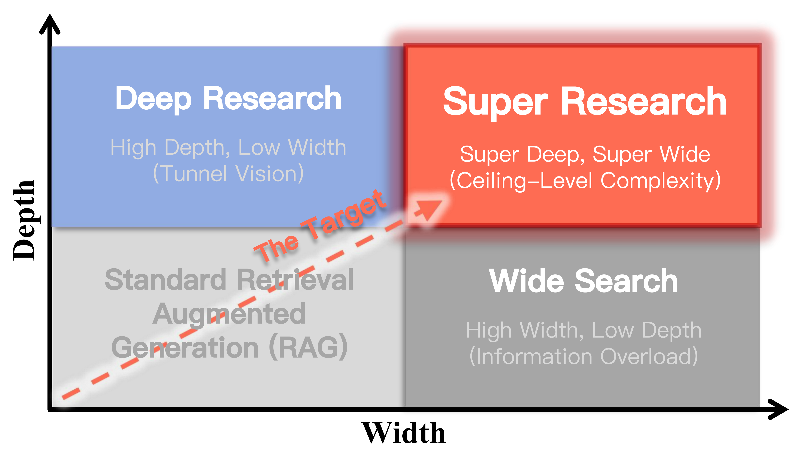

<div align="center">

# Super Research Benchmark

### Complex questions. Broad evidence. Deep reasoning.

**300 research questions · 10 domains · 12 systems · 3,600 agent reports**

<p>
  <a href="https://arxiv.org/abs/2603.00582"></a>
  <a href="https://cnsdqd-dyb.github.io/Super-Research-Benchmark/"></a>
  <a href="#dataset"></a>
  <a href="#agent-reports"></a>
  <a href="#how-to-test"></a>
  <a href="#citation"></a>
</p>

[Overview](#overview) · [News](#news) · [Dataset](#dataset) · [Reports](#agent-reports) · [Metrics](#evaluation-metrics) · [How to test](#how-to-test)

<a href="figures/intro_01.png"></a>

</div>

## Overview

Super Research studies autonomous research on complex, open-ended questions that require planning, gathering evidence across sources, and developing a coherent explanation. The benchmark covers **300 English questions across ten domains**, with a collection of **3,600 original reports from twelve research systems**.

Use the questions to test your research agent, inspect complete reports to compare research approaches, and describe system performance through five evaluation dimensions: **Coverage, Conditional Depth, Utility, Consistency, and Objectivity**.

This repository accompanies [*Super Research: Answering Highly Complex Questions with Large Language Models through Super Deep and Super Wide Research*](https://arxiv.org/abs/2603.00582).

## News

- **2026-10-13** — Released the maintained 300-question English dataset, complete 300-task report collections for twelve systems, and offline dataset validation and report preparation tools.
- **2026-03-03** — Updated the [Super Research paper](https://arxiv.org/abs/2603.00582).

## Dataset

The dataset spans science and engineering, finance and business, medicine and health, society and humanities, arts and creativity, transportation and logistics, environment and energy, consumption and e-commerce, tourism and leisure, and interdisciplinary research.

| Resource | Contents | Link |
|---|---|---|
| Questions | 300 English questions, task IDs, domains, and content hashes | [questions.jsonl](data/questions.jsonl) |
| Systems | Twelve systems and their recorded model names | [systems.json](data/systems.json) |
| Report index | Task and system identifiers, report paths, and content hashes | [report_manifest.jsonl](data/report_manifest.jsonl) |
| Full report collections | 300 original Markdown reports per system | [reports/](data/reports/) |
| Download | Questions and complete report archive | [Download ZIP](https://github.com/cnsdqd-dyb/Super-Research-Benchmark/releases/download/v2026.10.13/SuperResearch_300_EN_reports.zip) |

Questions have stable IDs such as `1:1`, `2:1`, and `3:1`. Each record includes `question`, `domain`, `language`, and `question_sha256`.

```python
import json
from pathlib import Path

questions = [json.loads(line) for line in Path("data/questions.jsonl").read_text(encoding="utf-8").splitlines()]
print(questions[0]["task_id"])
print(questions[0]["question"])
```

## Agent reports

Each included system has a complete collection of **300 reports**, organized by task ID. The report text and source links are preserved in Markdown.

| System | Recorded model | Reports |
|---|---|---:|
| Alibaba | Tongyi DeepResearch 30B A3B | 300 |
| Anthropic | Claude 3.5 Sonnet | 300 |
| DeepSeek | DeepSeek R1 | 300 |
| Google | Deep Research Pro Preview 12-2025 | 300 |
| Meta | Llama 3.3 70B Instruct | 300 |
| MiniMax | MiniMax M2.1 | 300 |
| Moonshot | Kimi K2 Turbo Preview Web Search | 300 |
| OpenAI | o3 Deep Research | 300 |
| OpenAI | o4-mini Deep Research | 300 |
| Perplexity | Sonar Deep Research | 300 |
| Qwen | Qwen 2.5 72B Instruct | 300 |
| xAI | Grok 4.1 Fast Web Search | 300 |

Exact model identifiers and system-to-folder mappings are in [systems.json](data/systems.json). To prepare one system's full report collection in the submission format:

```bash
python scripts/benchmark.py export --system system_01 --output outputs/alibaba.jsonl
```

## Evaluation metrics

| Dimension | What it measures |
|---|---|
| **Coverage** | Support for reference knowledge nodes in the report. |
| **Conditional Depth** | Advancement of displayed arguments given their explicit premises and inference validity. |
| **Utility** | Usefulness and actionable completeness for the research task. |
| **Consistency** | Support along reference reasoning paths. |
| **Objectivity** | Agreement of assessed claims with reference evidence. |

The five dimensions are displayed separately. Consistency is retained as a path diagnostic and is excluded from the default aggregate. See [the metric guide](docs/METRICS.md) for definitions and [the testing guide](docs/TESTING.md) for input formats.

## How to test

The supplied tools run with **Python 3.10+** and use only the standard library.

### 1. Get the dataset

```bash
git clone https://github.com/cnsdqd-dyb/Super-Research-Benchmark.git
cd Super-Research-Benchmark
python scripts/benchmark.py verify
python scripts/benchmark.py stats
```

### 2. Prepare tasks for your agent

Export a reproducible subset or all 300 questions:

```bash
python scripts/benchmark.py tasks --limit 10 --output outputs/tasks_10.jsonl
python scripts/benchmark.py tasks --output outputs/tasks_300.jsonl
```

Run your agent on each `question` and save its complete answer as `report_text`. Retain the `task_id` and `question_sha256` in each result:

```python
result = {
    "task_id": question["task_id"],
    "question_sha256": question["question_sha256"],
    "system_id": "my-research-agent",
    "report_text": agent.run(question["question"]),
}
```

Write one JSON object per line to `outputs/my_agent.jsonl`.

### 3. Check your report collection

```bash
python scripts/benchmark.py validate --input outputs/my_agent.jsonl
python scripts/benchmark.py validate --input outputs/my_agent.jsonl --require-complete
```

Validation checks task IDs, question hashes, nonempty reports, duplicate entries, and task coverage. To check the released report format immediately:

```bash
python scripts/benchmark.py export --system system_01 --output outputs/alibaba.jsonl
python scripts/benchmark.py validate --input outputs/alibaba.jsonl --require-complete
```

These commands prepare and validate report collections. Metric assessment is described in [the testing guide](docs/TESTING.md); validation itself does not assign metric scores.

## Repository layout

```text
data/
  questions.jsonl             # English research questions
  systems.json               # Recorded system and model identifiers
  report_manifest.jsonl      # Report index
  reports/system_*/          # Complete Markdown reports
  checksums.json             # Data integrity hashes
docs/
  METRICS.md                 # Five evaluation dimensions
  TESTING.md                 # Report format and testing workflow
scripts/
  benchmark.py               # Offline dataset and report tools
figures/                     # Project figures
index.html                   # Project website
```

## Citation

If you use Super Research questions or reports in your work, please cite:

```bibtex
@article{superresearch2026,
  title={Super Research: Answering Highly Complex Questions with Large Language Models through Super Deep and Super Wide Research},
  author={Dong, Yubo and You, Nianhao and Hou, Yuxuan and Sun, Zixun and Zhang, Yue and Zhang, Liang and Zhao, Siyuan and Fan, Hehe},
  journal={arXiv preprint arXiv:2603.00582},
  year={2026},
  url={https://arxiv.org/abs/2603.00582}
}
```
