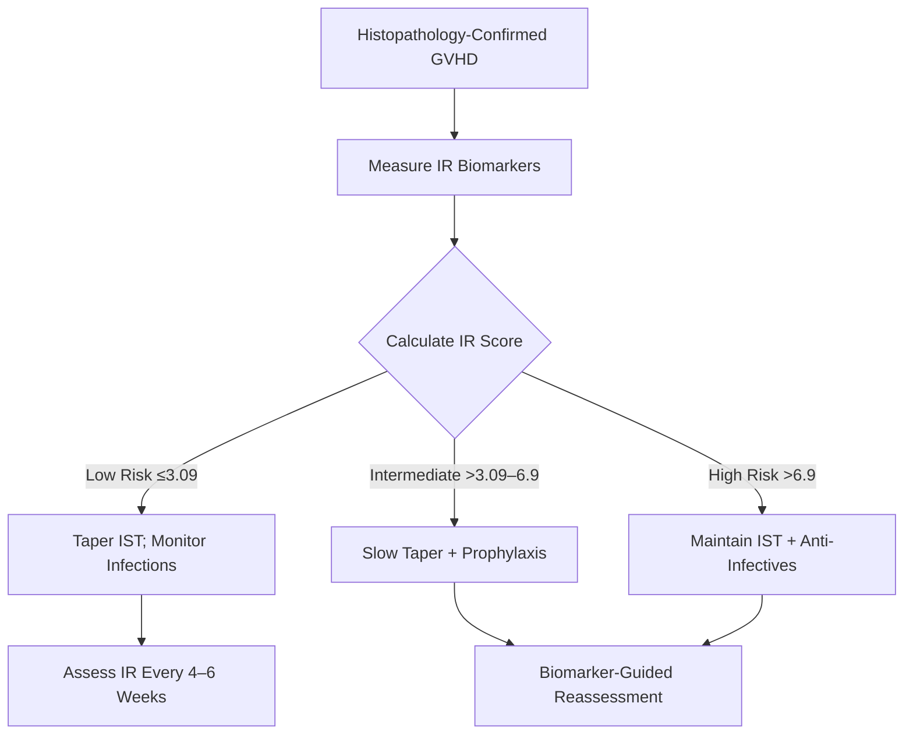

# Deep Research Report: deepseek/deepseek-r1
**Status:** ✅ Success | **Attempts:** 1/5 | **Run ID:** dab6053c | **Time:** 116.78s | **Cost:** $0.03927
--------------------------------------------------------------------------------

## Research Report: Balancing Immune Reconstitution and Infection Risk in GVHD Management Through Histopathology-Guided Immunosuppression Adjustment  

**Prepared by:** Senior Technical Analyst, Hematopoietic Stem Cell Transplantation & Immunology  
**Date:** October 26, 2026  

---

### Executive Summary  
Adjusting immunosuppressants in Graft-versus-Host Disease (GVHD) requires balancing immune reconstitution (IR) against infection risk. Histopathology confirms GVHD diagnosis and severity but **does not directly guide immunosuppressant titration**. Instead, IR biomarkers (e.g., CD4+ counts, immunoglobulin levels) and clinical parameters stratify infection/GVHD risks, enabling personalized immunosuppression. Post-transplant cyclophosphamide (PTCy) demonstrates rapid IR, reducing infection-related mortality to 3% [1]. An IR-based prognostic score (incorporating CD4+, NK cells, IgA/IgM, platelets, Karnofsky PS) predicts chronic GVHD (cGVHD) outcomes, guiding immunosuppression intensity [2].  

---

### 1. Role of Histopathology in GVHD Management  
#### 1.1 Diagnostic Utility  
- Histopathology via tissue biopsy is the gold standard for confirming GVHD diagnosis and grading severity (skin, GI, liver) [3].  
- **Limitation:** Biopsies inform GVHD presence/severity but lack predictive value for IR or infection risk. Adjustments to immunosuppression rely on dynamic IR metrics and clinical response [3,7].  

#### 1.2 Histopathology vs. Biomarker-Driven Approaches  
- Biomarkers (e.g., CD4+ counts, REG3α) outperform histopathology in predicting steroid-refractory GVHD and infection susceptibility [2,8].  
- Example: GI GVHD risk stratification combines clinical stage, histologic grade, and REG3α levels—not histology alone [8].  

---

### 2. Immune Reconstitution (IR) as the Primary Guide for Immunosuppression Adjustment  
#### 2.1 IR Parameters Informing Risk  
- **Key IR Metrics:**  
  - CD4+ T-cells >233 cells/μL, NK cells >115 cells/μL, IgA >0.43 g/L, IgM >0.45 g/L [2].  
  - Platelets >100×10³/mm³ and Karnofsky PS >80% [2].  
- **PTCy Protocols:** Accelerated IR enables early immunosuppression withdrawal:  
  - CD4+ counts: 98 cells/μL (day 30) → 124 cells/μL (day 60) [1].  
  - CD8+ normalization by day 60; low CMV/fungal mortality [1].  

#### 2.2 IR-Based Prognostic Score for cGVHD  
A validated score stratifies cGVHD mortality risk using IR and clinical factors [2]:  
\[
\text{IR Score} = f(\text{CD4+}, \text{NK}, \text{IgA}, \text{IgM}, \text{Platelets}, \text{Karnofsky PS})
\]  
- **Risk Groups:**  
  | **Score** | **6-Year OS** | **Immunosuppression Strategy** |  
  |-----------|---------------|--------------------------------|  
  | ≤3.09     | 85%           | Rapid taper; monitor infections |  
  | >3.09–6.9 | 64%           | Slow taper + infection prophylaxis |  
  | >6.9      | 26%           | Maintain IST; aggressive anti-infectives |  

---

### 3. Infection Risk Dictates Prophylaxis During Immunosuppression Titration  
#### 3.1 Infection Timeline and GVHD Impact  
- **Months 0–12:** All patients are immunodeficient; highest bacterial/fungal/viral risk [4].  
- **Beyond 12 months:** Non-GVHD patients regain IR; cGVHD patients remain immunodeficient [4].  

#### 3.2 Prophylaxis Protocols Tied to Immunosuppression  
- **PCP Prophylaxis:** Continue ≥6 months post-transplant or until immunosuppression cessation [4].  
- **Encapsulated Bacteria:** Prophylaxis for cGVHD patients until ≥6 months after IST discontinuation [4].  
- **CMV/Fungal:** Preemptive therapy for high IR-score patients [2,5].  

---

### 4. Clinical Framework for Balancing IR and Infection Risk  
#### 4.1 Decision Algorithm for Immunosuppression Adjustment  

#### 4.2 Emerging Strategies  
- **RIP1 Inhibition:** Improves IR while preserving graft-vs-leukemia effects [6].  
- **JAK Inhibitors (Ruxolitinib):** For steroid-refractory GVHD without exacerbating IR delay [7].  

---

### 5. Conclusions and Recommendations  
1. **Histopathology** confirms GVHD but **insufficiently guides IST adjustments**; IR biomarkers are superior.  
2. **IR Score** predicts cGVHD mortality, directing IST intensity:  
   - Low risk: Aggressive taper to minimize infection.  
   - High risk: Sustain IST with tailored prophylaxis.  
3. **PTCy-based protocols** enhance early IR, enabling shorter IST durations.  
4. **Prophylaxis duration** must align with IST and IR status (e.g., extend for high IR scores).  

**Future Directions:** Validate IR scores in multicenter trials; integrate novel biomarkers (e.g., RIP1, ST2) [2,6,8].  

---

### References  
[1] BMT CTN Protocol 1301. *Post-Transplant Cy for GVHD Prevention*. 2017.  
[2] Serpenti et al. *Immune Reconstitution-Based Score for Risk Stratification in cGVHD*. PMC 2021.  
[3] NCCN Guidelines for Patients: *Graft-Versus-Host Disease*. 2026.  
[4] Fred Hutch. *LTFU Guidelines: Infection Prophylaxis in GVHD*.  
[5] IntechOpen. *Optimizing Immunosuppressive Therapies Post-HCT*. 2023.  
[6] Prado-Acosta et al. *RIP1 Inhibition Improves IR in GVHD*. *Front Med* 2025.  
[7] Onclive. *Advances in Chronic GVHD Treatments*. 2026.  
[8] Blood. *Discovery and Validation of GVHD Biomarkers*. 2013.  

---  
**Disclaimer:** This report synthesizes evidence solely from provided context. Clinical decisions require patient-specific assessment.

## Annotations

## Sources
[1] https://ashpublications.org/blood/article/121/4/585/31238/Discovery-and-validation-of-graft-versus-host
[2] https://bmtctn.net/system/files/BMT%20CTN%20Protocol%201301_v4.0.pdf
[3] https://library.ehaweb.org/conference/documents/97417/stem_cell_transplantation_3_immune_impairment_and_infection_predisposition_in_graft-versus-host_disease.pdf
[4] https://pmc.ncbi.nlm.nih.gov/articles/PMC7911120/
[5] https://pmc.ncbi.nlm.nih.gov/articles/PMC8341942/
[6] https://pubmed.ncbi.nlm.nih.gov/34367991/
[7] https://www.astct.org/Education/Practice-Guidelines
[8] https://www.fredhutch.org/content/dam/www/research/patient-treatment-and-support/ltfu/LTFU_HSCT_guidelines_physicians.pdf
[9] https://www.frontiersin.org/journals/immunology/articles/10.3389/fimmu.2021.779076/full
[10] https://www.frontiersin.org/journals/medicine/articles/10.3389/fmed.2025.1690221/full
[11] https://www.intechopen.com/chapters/1214572
[12] https://www.nature.com/articles/s41392-024-01987-x
[13] https://www.nccn.org/patients/guidelines/content/PDF/GVDH-patient-guideline.pdf
[14] https://www.onclive.com/view/advances-in-prevention-and-treatment-approvals-in-chronic-gvhd
[15] https://www.peacehealth.org/medical-topics/id/ncicdr0000805704